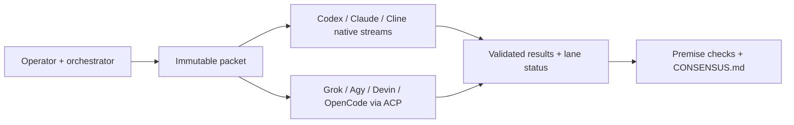

# xcheck

**One review packet. Independent agent processes. Evidence before agreement.**

xcheck sends an immutable packet to other coding-agent CLIs, collects their natively completed answers, and leaves the final decision to the orchestrator. It uses existing native logins; it does not provision API accounts or enable billing.



The runner owns process control, quota admission, pool locks, snapshots, completion parsing and validation. The orchestrator owns scope, evidence, reviewer selection and judgment. There is no reviewer vote and no automatic retry of a review turn.

[Start here](docs/adoption.md) · [Full protocol](Multi-Agent%20Cross-Check%20Protocol.md) · [Local integration](docs/local-integration.md) · [Examples](examples/README.md)

## Try it without accounts

Requires Python 3.12+ on macOS. The runtime is standard library only.

```bash
git clone https://github.com/yarco/xcheck.git
cd xcheck
python3 examples/offline_demo.py
```

This installs into a disposable HOME and runs two fake native streams. It verifies installation, local configuration, packet snapshots, completion and proof validation. It calls no real model or account and does not establish review quality.

## Use your native subscriptions

Install and sign in to the peer CLIs you choose, then:

```bash
python3 bin/xcheck install
export PATH="$HOME/.local/bin:$PATH"
xcheck doctor
python3 examples/stage_demo.py /tmp/agent-offload/my-first-review
xcheck run --base /tmp/agent-offload/my-first-review --orch claude \
  --lanes codex:gpt-6.1-sol:high --web packet
```

Use your actual orchestrator kind and a fresh BASE each time. The model ID above is a repository pin, not a promise of current account availability. Admission checks the selected lane again before inference. `doctor` checks the whole supported roster and can report gaps unrelated to your chosen lane.

A real run consumes the selected native subscription or provider allowance. A zero-price offer still needs current price/access verification and acceptable data terms. No live model review is required for the offline example.

## The workflow

1. Stage whole source files, provenance, task and output schema. Put an unpredictable token in the proof target last.
2. Launch once. Every lane receives the same captured packet. The orchestrator's own harness cannot be a peer.
3. Retain one host wait or a verified completion callback. Silence is pending; there is no default review timeout. Interrupting a waiter detaches it.
4. Collect final assistant messages only after native turn completion. Validate heading, review text, proof and final marker. Report every skipped, failed or invalid lane.
5. Open the real files to check findings' premises. Record confirmed, rejected and uncertain rulings in `CONSENSUS.md`; verify each admitted repair independently.

`done` means the answer met the output contract. It does not mean the reviewer was correct, read every file, stayed within all instructions, or supplied independent evidence.

| Need | Command |
|---|---|
| Inspect readiness and current offers | `doctor`, `capacity`, `models` |
| Launch once | `run --base B --orch H` |
| Reattach without relaunching | `wait --base B` |
| Inspect states or text-free progress | `status --base B`, `activity --base B` |
| Intentionally stop work | `cancel --base B --reason TEXT` |

## Boundaries

Supported scope is one operator on one macOS machine, with attended runs. Codex, Claude and Cline use first-party headless streams; Grok, Agy, Devin and OpenCode use stock acpx and their native ACP servers. Optional Herdr placement needs a verified caller-context adapter; otherwise auto mode is headless.

This is not an isolation boundary for hostile evidence. Some peers retain shell, network or local-tool access beyond the packet; `--web packet` disables supported built-in web tools and requests no retrieval, but cannot enforce general network isolation. Review your configured tools and native account terms before sharing private material. Machine-local adapters, configuration, logs and transcripts belong outside version control.

## Develop

```bash
uv run --python '>=3.12' --with-requirements requirements-test.txt pytest
git diff --check
```

Tests use disposable homes, isolated pools and fake CLIs. The optional long acceptance command and adapter qualification rules are in the full protocol. After runtime edits, reinstall from the intended source checkout and run `xcheck doctor`.

[MIT](LICENSE)
